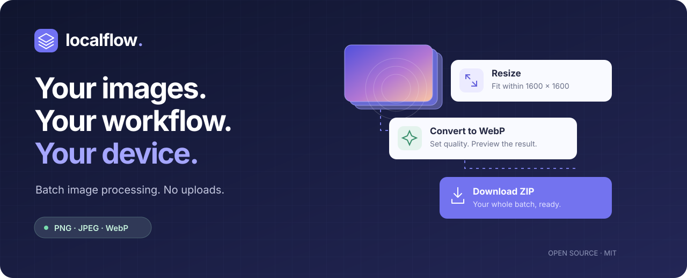

# LocalFlow



[](https://github.com/enestanerr/LocalFlow/actions/workflows/ci.yml)
[](LICENSE)
[](package.json)

**Build an image workflow once. Run it on your whole batch. Keep your files on your device.**

LocalFlow is an open-source image workspace that runs in your browser. Resize, crop, rotate, flip, convert, and rename PNG, JPEG, and WebP images with an editable sequence of steps. Compare the actual encoded result before processing the batch, then download individual outputs or one ZIP.

No account, API key, image upload, analytics, or paid service is required.

[Quick start](#try-it-locally) · [Recipes](examples/README.md) · [Architecture](docs/ARCHITECTURE.md) · [Contributing](CONTRIBUTING.md) · [Türkçe](README_TR.md)

## Why LocalFlow?

Preparing a folder of product shots, screenshots, or web images often means repeating the same edits. LocalFlow turns those edits into a reusable recipe: inspect one real output, adjust the steps, and run the recipe across the batch.

| You need to…              | LocalFlow gives you…                                     |
| ------------------------- | -------------------------------------------------------- |
| Prepare consistent assets | Ordered resize, crop, rotate, and flip steps             |
| Choose an export format   | Actual encoded previews with file size and dimensions    |
| Repeat the same workflow  | Portable JSON recipes and links containing settings only |
| Work with private images  | Local processing and no image upload endpoint            |
| Deliver the whole folder  | Safe filenames and one ZIP download                      |

## Try it locally

Requires Node.js **22.13 or newer** and npm.

```sh
git clone https://github.com/enestanerr/LocalFlow.git
cd LocalFlow
npm ci
npm run dev -- --port 4318
```

Open **http://localhost:4318** and choose **Try 3 sample images**. Select an image, adjust a workflow step, and choose **Process 3 images**. The sample images are generated on your device.

For a production build:

```sh
npm run build
npm start
```

On Windows, `start-localflow.cmd` installs dependencies when needed, builds the application when no build exists, and starts the local production server. The server binds only to `127.0.0.1`.

## What works

| Step               | Controls                                                                       |
| ------------------ | ------------------------------------------------------------------------------ |
| Resize             | Fit within maximum width and height, preserve aspect ratio, optional upscaling |
| Crop               | 1:1, 4:3, 3:2, 16:9, or 9:16; center or edge anchoring                         |
| Rotate             | 90°, 180°, or 270° clockwise                                                   |
| Flip               | Horizontal or vertical                                                         |
| Convert & compress | WebP, JPEG, or PNG; lossy quality; explicit JPEG background color              |
| Rename             | `{name}`, `{n}`, `{width}`, and `{height}`; configurable starting number       |

- Drag steps or use the accessible up/down buttons to change their order.
- Turn steps on or off without deleting their settings.
- See full-resolution encoded previews, actual file sizes, and output dimensions.
- Run a sequential batch with progress, cancellation, and per-file errors.
- Download completed outputs individually or together as a ZIP. Colliding names receive a suffix instead of overwriting another image.
- Start from three presets, restore your last valid recipe, and save a favorite on this device.
- Import/export versioned recipe JSON, or share a URL fragment containing only recipe settings.

Image operations run in their listed order. Format, quality, and filename settings apply once at export. Each step type can appear once. Exported images are re-encoded even when no image operation is active.

## Privacy and limits

- Image contents are never sent to a server. File objects and preview URLs live in browser memory and are discarded when the page closes.
- Recipes are stored in `localStorage`; images are not. Storage is optional, and recipe links work even when local storage is unavailable.
- Shared links contain settings, including any text you put into the filename pattern. They contain no input images. A recipient needs access to the same application URL; localhost links are only useful on the same computer.
- Processing and export require no network connection **after the application has fully loaded**. Offline reload/install support is not included.
- Still PNG, JPEG, and WebP only. Animated PNG/WebP are rejected rather than silently reduced to a single frame.
- Maximum 100 images, 200 MB input/output per batch, 32 MB per file, 8,192 px per side, and 24 megapixels per image.
- Source EXIF and GPS metadata are not copied. Browsers may write their own encoding metadata and may change color profiles. This is not a professional print/color-management tool.
- PNG encoding is lossless and ignores quality. JPEG fills transparency with the selected background. Browser encoder support is checked; unsupported formats are reported explicitly.
- EXIF orientation uses the browser's `createImageBitmap(..., { imageOrientation: 'from-image' })` implementation. Browser-specific orientation and color behavior needs real-browser validation before a public launch.

## Recipes

```json
{
  "version": 1,
  "name": "Web-ready images",
  "steps": [
    {
      "id": "step-resize",
      "type": "resize",
      "enabled": true,
      "width": 1600,
      "height": 1600,
      "enlarge": false
    },
    {
      "id": "step-format",
      "type": "format",
      "enabled": true,
      "format": "webp",
      "quality": 80,
      "background": "#ffffff"
    },
    {
      "id": "step-rename",
      "type": "rename",
      "enabled": true,
      "template": "{name}-{n}",
      "start": 1
    }
  ]
}
```

Imports are size-bounded and validated before replacing the active recipe. Unknown fields are discarded; unsupported versions, duplicate steps, and invalid settings are rejected.

## Development

```sh
npm run typecheck
npm run lint
npm test
npm run build
```

- `components/localflow.tsx`: workspace, input lifecycle, preview and batch orchestration.
- `components/step-settings.tsx`: operation controls using the bundled accessible UI primitives.
- `lib/recipe.ts`: versioned schema validation, presets, sharing, and portable filenames.
- `lib/image-engine.ts`: header validation, geometry, decode/encode, cancellation, and resource cleanup.
- `lib/download.ts`: ZIP creation and browser downloads.
- `tests/`: real PNG/JPEG/WebP fixtures encoded with native Canvas, plus recipe and ZIP tests.
- `scripts/serve.mjs`: dependency-free local server for the production output.

The UI uses React and TypeScript on the Sites/Vinext scaffold. Production output is static: `dist/client/`. No server runtime or database is required to host it at a domain root. Keep all emitted client assets and route payload files together. Personal hosting configuration is optional and excluded from version control; a fresh clone builds without it.

Native Canvas tests verify pixels and binary outputs; they are not a substitute for browser interaction, responsiveness, or accessibility checks. See [validation scope](docs/VALIDATION.md) for completed coverage and remaining browser checks. Vendored UI primitives are excluded from the application linter instead of rewriting the scaffold's library code.

Run all validation commands with `npm run check`. CI runs them on Ubuntu and Windows. See [architecture](docs/ARCHITECTURE.md) for the processing contract and [changelog](CHANGELOG.md) for release changes.

## Contributing

Read [CONTRIBUTING.md](CONTRIBUTING.md) to get started. [Report a bug](https://github.com/enestanerr/LocalFlow/issues/new?template=bug_report.yml) with a small reproducible example, or [suggest a workflow improvement](https://github.com/enestanerr/LocalFlow/issues/new?template=feature_request.yml). Only attach images you are comfortable making public.

For security findings, follow [SECURITY.md](SECURITY.md).

## License

MIT. See [LICENSE](LICENSE) and [third-party notices](THIRD_PARTY_NOTICES.md).
