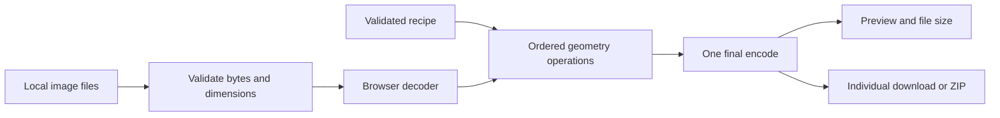

# Architecture

LocalFlow is a static React/TypeScript application. Image processing runs in the browser using Canvas and `createImageBitmap`. The application has no image-processing backend.

## Responsibilities

| Module                         | Responsibility                                                                                |
| ------------------------------ | --------------------------------------------------------------------------------------------- |
| `components/localflow.tsx`     | Workspace state, input ownership, preview lifecycle, operation locks, batch progress, dialogs |
| `components/step-settings.tsx` | Controls for the selected operation                                                           |
| `lib/recipe.ts`                | Version 1 schema, presets, URL encoding, output filenames                                     |
| `lib/image-engine.ts`          | Byte inspection, decode, transforms, encode, cancellation, resource cleanup                   |
| `lib/download.ts`              | ZIP assembly and browser downloads                                                            |
| `scripts/serve.mjs`            | Local static preview server; never receives images                                            |

## Processing contract

One instance of each step type is allowed. Enabled geometry steps run in list order. Format, quality, and filename settings are resolved at export so a workflow never applies repeated lossy encoding between steps.

Preview uses the same processing engine as the final batch. It is debounced and cancelled when superseded. Batches process one image at a time; completed files remain downloadable if a later file fails or processing is stopped.

A synchronous operation lock guards asynchronous imports, sample generation, file intake, batch processing, and ZIP assembly. A shared recipe received while busy is kept pending until the user loads it. Recipe changes cannot silently alter the active batch's snapshot.

Cancellation is cooperative: it is checked around asynchronous reads and decoding, between transforms, and around encoding. The browser cannot interrupt a synchronous Canvas operation already in progress.

## Data ownership

Files and output blobs live in tab memory. Object URLs are revoked when replaced or removed. Decoded images are closed, and intermediate canvases are cleared after use.

Only recipe settings are persisted in optional local storage. The URL fragment carries a bounded, validated recipe, never image bytes. Custom text in a filename template is part of the shared settings.

## Deployment

`npm run build` emits static files into `dist/client/`. Serve the entire directory at a domain root over HTTP(S), including route payload files and hashed assets. Opening `index.html` through `file://` is not a supported launch method.

The default checkout needs no account, hosting credential, environment variable, or database. A local `.openai/hosting.json`, when present, enables the optional Sites packaging plugin. That personal binding is excluded from version control.

No service worker is included. Processing can continue offline after all required application code has loaded, but offline reload/install is outside the current scope.
